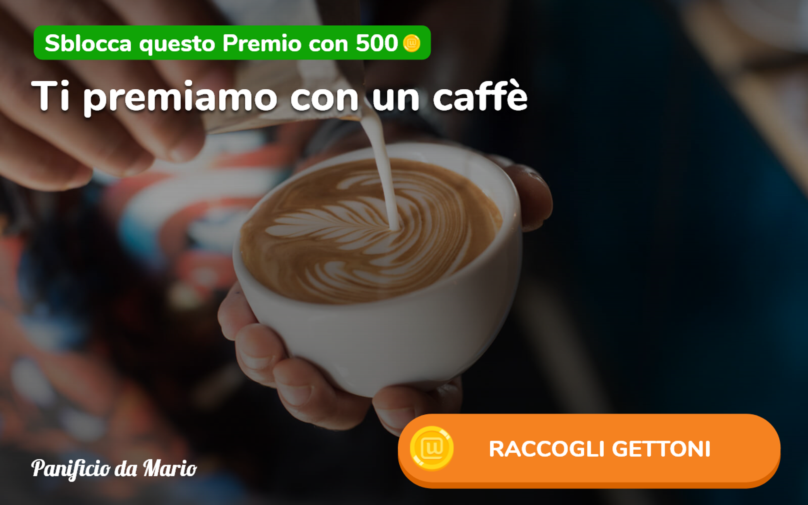
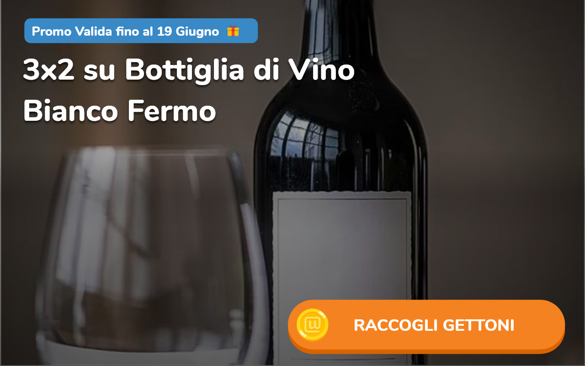
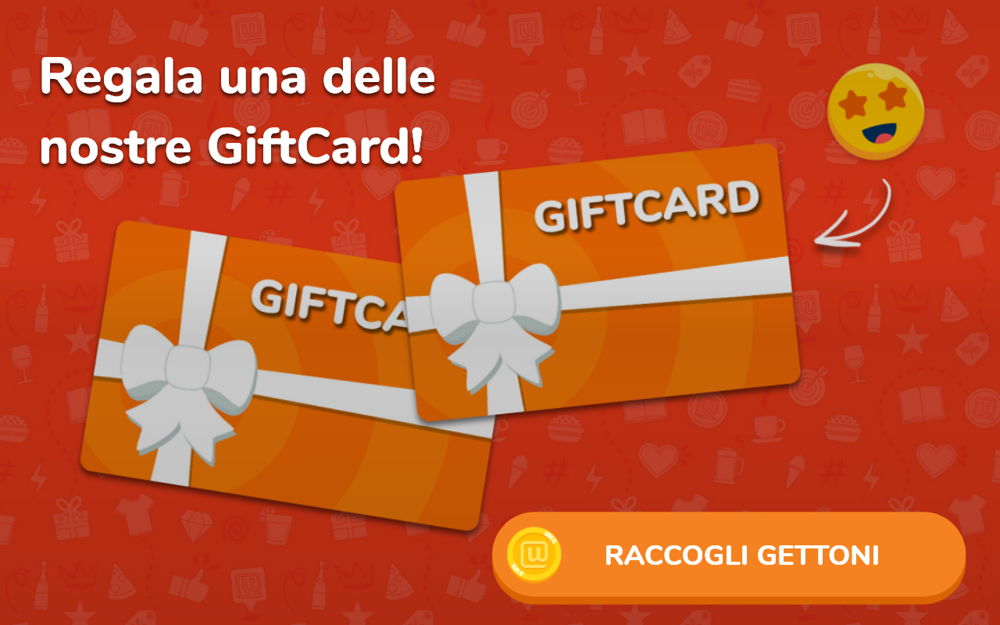

La sezione del Gestionale [Cover Chiosco](https://partner.unipiazza.it/cover) ti permette di selezionare quali immagini (o cover) appariranno sul tuo Chiosco. La trovi nel menù a sinistra, in **Vetrina** e poi **Chiosco**. Queste immagini sono fondamentali per attirare l'attenzione dei tuoi clienti e per comunicare offerte speciali, promozioni o novità.

La pagina ha due colonne, **Cover Attive** e **Cover Disattive**. Per crearne una nuova premi **Crea** in alto a destra e scegli **Cover Premio** (pubblicizza uno dei tuoi premi) o **Cover Generica** (per tutto il resto). Per cambiarne una premi la matita, per toglierla del tutto il cestino.

Nella finestra della cover scegli l'immagine, scrivi il **Testo principale** (fino a 80 caratteri) e l'**Etichetta** che compare sopra (fino a 60), poi la **Data di inizio**. Se vuoi che si spenga da sola, spunta **Imposta una data di fine** (al massimo fra un anno). Se hai più punti vendita, scegli anche in quali deve comparire.

Non c'è un interruttore per accendere o spegnere una cover, perché a decidere sono le date. Una cover è attiva dalla data di inizio fino alla data di fine, e finita quella passa da sola tra le Disattive. Per toglierla prima, eliminala con il cestino oppure metti come data di fine un momento già passato. Sul Chiosco ci sono sempre almeno due cover, e se le tue attive sono meno di due ne aggiungiamo noi una del tuo programma fedeltà (per esempio un tuo premio).

🕒 **Solo in certi giorni e orari** Vuoi una cover solo a pranzo o solo nel weekend? Spunta **Seleziona manualmente i giorni**, scegli i giorni e per ognuno l'orario. Con **Aggiungi orario** imposti una seconda fascia nello stesso giorno, per esempio 12:00-15:00 e 19:00-23:00. Per usare gli orari serve anche la data di fine.

Ecco alcuni esempi per sfruttare le cover: 

1.  **Premi Fedeltà**
    
    Incentiva i tuoi clienti ad iscriversi creando delle Cover ad Hoc che pubblicizzano dei premi Fedeltà. 
    

2.  **Offerte Speciali**
    
    Utilizza una cover per mostrare un'offerta speciale, come "3x2 su Bottiglia di vino bianco fermo”
    

3.  **Eventi o Novità**
    
    Hai un nuovo prodotto o un evento speciale? Evidenzialo con una cover.
    

.png)

4.  **Promozioni Stagionali**
    
    Le festività sono un ottimo momento per creare cover tematiche che attirano l'attenzione.
    

.png)

5.  **Promo Iscrizione**
    
    Invita i tuoi clienti creando una Cover che li ingolosisca. Degli Esempi “Iscriviti e ottieni subito 50 gettoni”, “Iscriviti e inizia a premiarti!”
    

.png)

6.  **Booster Gettoni**
    
    Pubblicizza un Booster gettoni attivo in quel giorno e orario, che moltiplichi i gettoni per 1,5, per 2 o per 3.
    

.png)

7.  **Abbonamenti Prepagati**
    
    Pubblicizza gli Abbonamenti Prepagati attivi in quell’esatto giorno e orario.
    

.png)

8.  **GiftCard**
    
    Promuovi le tue GiftCard con una cover che invita i clienti a scoprirne i benefici, ideale per regali o come comodo metodo di pagamento anticipato.  
    

9.  **Wallet Gettoni **Utilizza una cover per far conoscere il Wallet, uno strumento pratico per raccogliere gettoni e accedere a vantaggi esclusivi presso il tuo locale.  
    

<table><tbody><tr><td colspan="1" rowspan="1">
<strong>🥳Viva le automazioni! </strong>Alcune cover nascono da sole. Quando crei un Booster o un Abbonamento, spunta <strong>Pubblicizza automaticamente</strong> e la cover la prepariamo noi. Quando mandi una Campagna Promo o Evento a tutti i tuoi clienti, la cover compare senza che tu debba fare nulla. Un Booster riservato a una lista di clienti, invece, non si può pubblicizzare sul Chiosco.
</td></tr></tbody></table>

**Quanto dura una cover automatica?** Per le Campagne Promo ed Evento la cover segue le date della campagna, e le sue date non si possono cambiare. Compare alla data di inizio e si disattiva da sola alla fine dell'ultimo giorno. Le cover che crei a mano restano attive fino alla data di fine, se l'hai impostata, oppure finché non le elimini.
